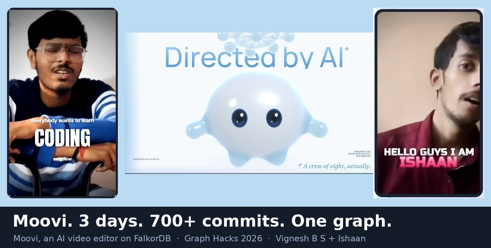
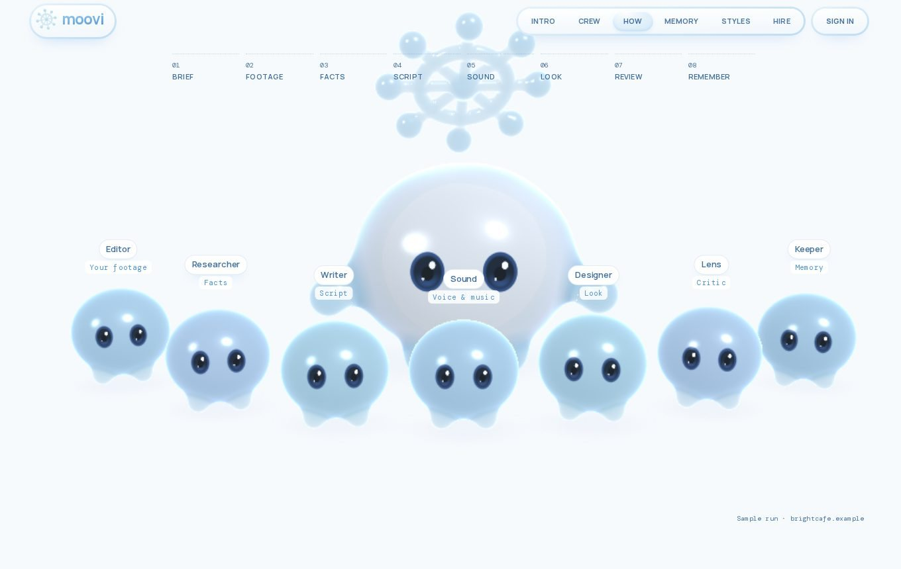
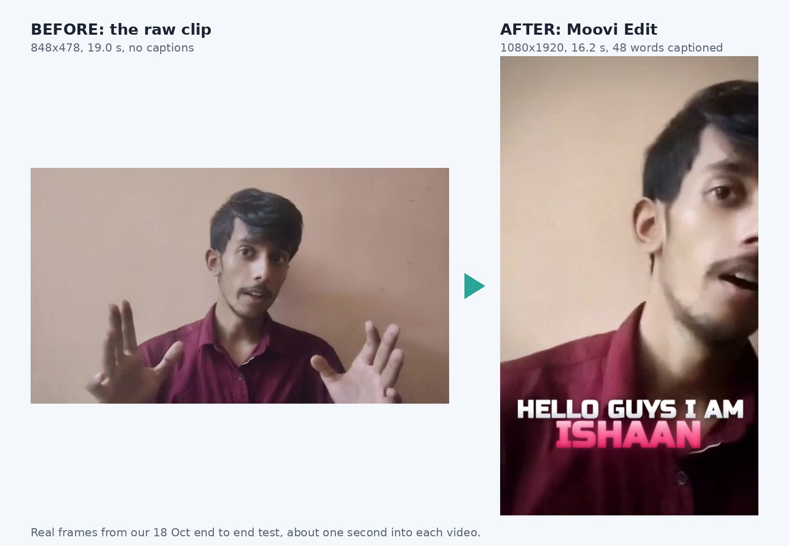
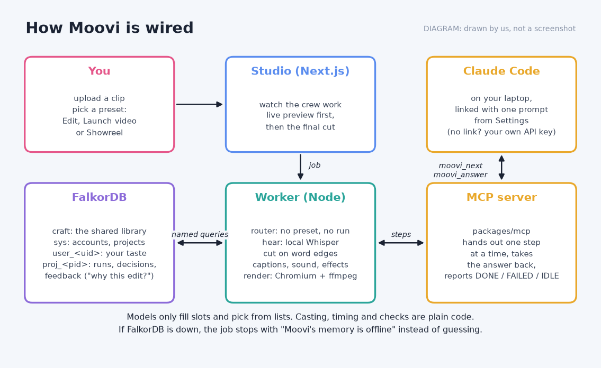
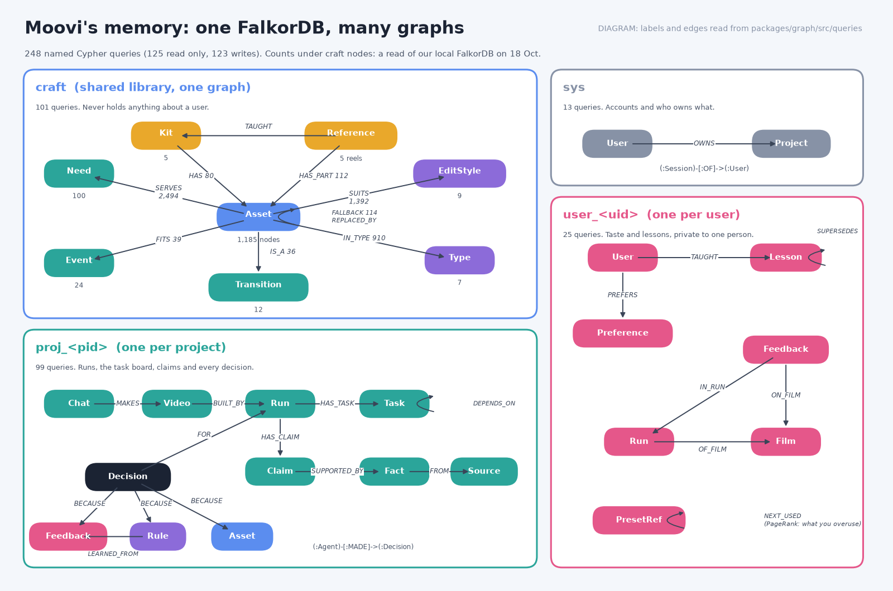
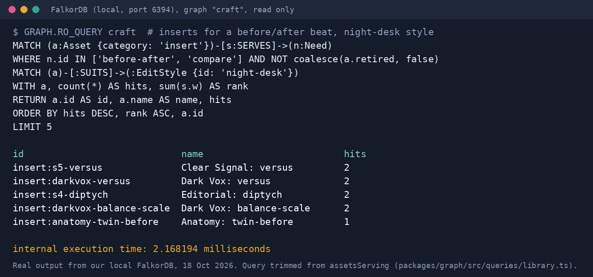
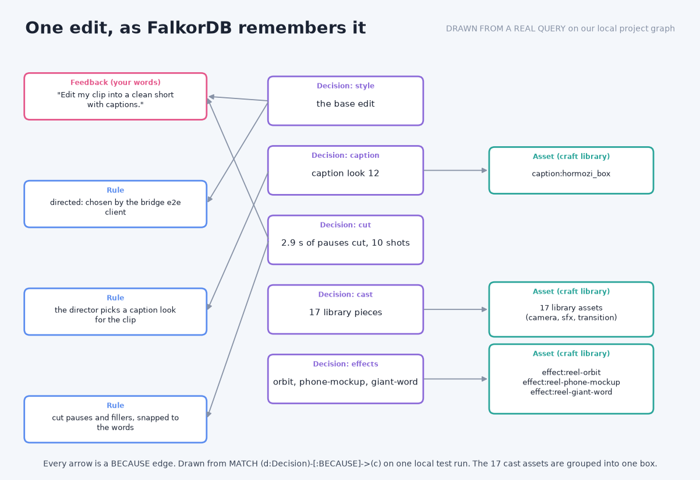

# Moovi

**Hire Moovi.** Moovi is an AI video director who leads a visible crew of agents to make and edit your videos, and remembers how you like them. Every choice the crew makes is a node in a FalkorDB graph with an edge back to its reason, so "why did you cut there?" is answered by a Cypher query, not a guess.

From the makers of MotionEasy and CaptionsEasy.

**Disclosure:** Landing page and MotionEasy renderer existed before Oct 15 and are used as libraries. The graph agent, MCP and studio were built Oct 15 to 18.

[](https://www.youtube.com/watch?v=9QYmooX4ffA)

| | |
|---|---|
| **Demo video** | https://www.youtube.com/watch?v=9QYmooX4ffA |
| **Live** | https://moovi-three.vercel.app (the studio is at `/studio`; bring your own Gemini, Groq or other model key) |
| **Hackathon** | Graph Hacks: Context for AI Agents, by WeMakeDevs x FalkorDB |
| **Tracks entered** | Track 01: Agents That Act on Connected Data · Track 02: Agent Memory and Coordination |
| **Graph database** | FalkorDB 6.0.2 (Docker), the only memory Moovi has |
| **Build blog** | [docs/submission/BLOG.md](docs/submission/BLOG.md): how the graph is wired and 17 things that broke |

The landing page runs on Vercel; the studio, the film-making worker and FalkorDB run on one AWS server
(`docs/DEPLOY.md`). Every push to `main` redeploys the landing page.

## What Moovi does

You pick one of three presets: **Edit** (your clip, cut and captioned), **Launch video** or **Showreel**. A crew then works on it in the studio, where you can watch each member at work: Moovi (the one you talk to) plus seven specialists, Editor, Researcher, Writer, Sound, Designer, Lens and Keeper. You get back a finished vertical video, and the next one is made with what Moovi learned about your taste.




*Real frames from our 18 October end to end test. Left: the raw clip. Right: Moovi's Edit.*

## Architecture



- **Studio** (`apps/studio`, Next.js, :3100): the brief, the Office (the crew at work, live) and the editor.
- **Engine worker** (`packages/engine`): a task scheduler on the graph, the crew's agents and the voice, render and sound workers.
- **Claude Code bridge** (`packages/mcp`): plug Moovi into your own Claude Code over MCP and it becomes the brain for a few batched decisions per video.
- **Graph** (`packages/graph`): the FalkorDB client, schema, seeds and the named Cypher query library every agent calls.

## How FalkorDB is used

FalkorDB is not a side store here. It holds the crew's task board, the shared style library, every user's memory and every decision with its reason. On the server, if FalkorDB is down the job stops with "Moovi's memory is offline". There is no silent fallback.

### One FalkorDB server, many graphs

| Graph | What it holds |
|---|---|
| `craft` | The shared library: caption looks, sounds, camera moves, transitions, effects, fonts and the reference reels they came from. Nothing about any user. 9,037 nodes on the production server (read over ssh on 18 Oct for the demo). |
| `styles` | Each style's set ups and the films it made, so a style never repeats itself. |
| `sys` | Accounts, sessions and who owns which project. |
| `user_<uid>` | One per user: their lessons, feedback, preferences and the presets their past films used. |
| `proj_<pid>` | One per project: chats, runs, the task board, facts, claims, scenes and every decision. |


*Every label and edge in this diagram is read from the queries in `packages/graph/src/queries`.*

### Agents call named queries, never raw Cypher

Agents never write Cypher of their own. They call one of **253 named queries** (129 read only, 124 writes) in `packages/graph/src/queries/`, each a `q(name, readOnly, meaning, cypher)` call, so the plain English meaning sits next to the Cypher. Read only queries run as `GRAPH.RO_QUERY`, so the server itself refuses a write. Every call has a timeout, is timed, and is attributed to the agent that ran it (`packages/graph/src/client.ts`). The full list, generated from the code: [docs/QUERIES.md](docs/QUERIES.md).

**The task board is a graph.** A film is a set of `(:Task)` nodes with `DEPENDS_ON` edges. A worker claims a ready task with a lease, and the `WHERE` makes it atomic, so two workers never take the same one (`project.ts`, `claim`):

```cypher
MATCH (t:Task {id: $id})
WHERE t.status = 'ready'
SET t.status = 'running', t.worker = $worker, t.lease_until = $lease, t.started_at = $at, t.attempts = t.attempts + 1
RETURN t.id AS id, t.kind AS kind, t.agent AS agent, t.resource AS resource, t.scope AS scope, t.title AS title,
       t.input AS input, t.attempts AS attempts, t.max AS max, t.feedback AS feedback, t.answer AS answer, t.reopened AS reopened
```

If a worker dies, its lease runs out and the task is ready again (`expired`). If a review sends work back, `reopen` puts that task and everything downstream of it back to waiting.

**Casting by need.** The Designer picks an asset by what the beat needs: assets `SERVE` needs, and the one that serves the most needs of this beat wins (`library.ts`, `assetsServing`):

```cypher
UNWIND $needs AS nid
MATCH (a:Asset {category: $category})-[s:SERVES]->(:Need {id: nid})
WHERE ($runtime IS NULL OR $runtime IN a.runtime) AND (NOT $shipOnly OR a.ship) AND NOT coalesce(a.retired, false)
WITH a, count(*) AS hits, sum(s.w) AS rank
RETURN a.id AS id, a.name AS name, a.runtime AS runtime, a.energy AS energy, a.params AS params, a.impl AS impl, hits
ORDER BY hits DESC, rank ASC, a.id
LIMIT $n
```



**The truth guard.** The Writer may not state a fact without a path from the claim to a fact and from the fact to its source. No path, no claim (`project.ts`, `truthGuard`):

```cypher
MATCH (c:Claim {id: $id})-[:SUPPORTED_BY]->(f:Fact)-[:FROM]->(s:Source)
WHERE f.status IN ['verified', 'user_stated']
RETURN f.id AS fact, f.text AS text, s.ref AS source
```

**Memory that changes over time.** Keeper files your notes as `(:Lesson)` nodes in your own user graph. A newer lesson does not delete the old one, it supersedes it (`user.ts`, `supersedeLesson`), and each agent reads only the lessons still valid for its role (`lessonsFor`):

```cypher
MATCH (n:Lesson {id: $id}), (o:Lesson {id: $old})
SET o.invalid_at = $at
MERGE (n)-[:SUPERSEDES]->(o)
```

### The three graph algorithms

There are exactly three, each copied from `main`. No vector search, no embeddings, no community detection.

**1. `shortestPath`: "why did you pick this?"** Every choice (style, caption look, cut, cast, effect, voice) is saved as a `(:Decision)` with `BECAUSE` edges to its causes: your words (`:Feedback`), a `:Rule`, a `:Reference` reel or a library `:Asset`. When you ask why, this walks back to the cause, your own words first (`why.ts`, `whyThis`). shortestPath explains a decision; it does not make it.

```cypher
MATCH (d:Decision)
WHERE d.kind IN $kinds AND ($run IS NULL OR d.run = $run)
WITH d ORDER BY d.at DESC LIMIT 1
MATCH (d)-[:BECAUSE]->(x)-[:LEARNED_FROM|FROM*0..3]->(c)
WHERE c:Feedback OR c:Rule OR c:Reference OR c:Asset
WITH DISTINCT d, c
WITH d, c, shortestPath((d)-[:BECAUSE|LEARNED_FROM|FROM*]->(c)) AS p
WITH d, c, p, CASE WHEN c:Feedback THEN 0 WHEN c:Reference THEN 1 WHEN c:Rule THEN 2 ELSE 3 END AS rank
RETURN d.id AS decision, d.kind AS kind, d.choice AS choice, d.why AS why, d.at AS at, length(p) AS hops,
       [m IN nodes(p) | {id: m.id, label: labels(m)[0], text: CASE WHEN m:Decision THEN m.choice ELSE coalesce(m.why, m.text, m.name, m.id) END}] AS path,
       [r IN relationships(p) | type(r)] AS rels
ORDER BY rank, hops DESC
LIMIT 6
```


*Drawn from a real query on the project graph of one local test run. Every arrow is a BECAUSE edge.*

**2. `algo.SPpaths`: the cheapest order of looks.** When Moovi makes a film from a written brief, the Director builds a small scratch lattice (one column per beat, one node per candidate preset, `NEXT` edges weighted by how badly one look flows into the next) and asks FalkorDB for the k cheapest paths. The Director gets them as a suggestion, "a starting point, not an order" (`project.ts`, `boardPaths`):

```cypher
MATCH (s:Lattice {id: $start}), (t:Lattice {id: $end})
CALL algo.SPpaths({sourceNode: s, targetNode: t, relTypes: ['NEXT'], weightProp: 'w', pathCount: $k, maxLen: $maxLen})
YIELD path, pathWeight
RETURN [n IN nodes(path) | n.preset] AS presets, pathWeight AS cost
ORDER BY cost ASC
```

**3. `algo.pageRank`: what you lean on too much.** Each user graph keeps the order of presets your past films used (`(:PresetRef)-[:NEXT_USED]->(:PresetRef)`). PageRank over it finds the looks at the centre of your habits, and that score is added to the lattice weights above so the next film leans away from them (`user.ts`, `overUse`). The same algorithm over `(:Setup)-[:NEXT_TO]->(:Setup)` finds what a style leans on (`styles.ts`, `overUsed`).

```cypher
CALL algo.pageRank('PresetRef', 'NEXT_USED')
YIELD node, score
RETURN node.id AS id, score
```

`SPpaths` and `pageRank` run on the written brief path. When you upload your own clip for an Edit, the graph still picks every camera move, sound and transition, by plain Cypher matching like `assetsServing` above.

### Pull the plug

Rule 3 says the graph must do real work. On the server, every graph read on the product path is required (decision 13): stop FalkorDB and the job refuses with "Moovi's memory is offline"; start it and Moovi answers again. The local fallbacks only run with `MOOVI_GRAPH_OPTIONAL=1`, a flag for tests and local development that the server never sets (`.env.example`). The demo script for it is `pnpm --filter @moovi/engine demo:graph-stop` (`packages/engine/scripts/demo-graph-stop.ts`), and `packages/engine/test/graph-required.test.ts` checks it.

### Data

Only data we are allowed to use goes into the graph: the style library is our own (from MotionEasy) plus openly licensed assets, each listed with its licence in `packages/engine/assets/CREDITS.md`; clips a user uploads are their own; footage Moovi finds is stored with its `(:Source)` and `(:Licence)`.

## Repository

```
moovi/
├─ apps/
│  ├─ studio/         the studio: brief → the Office (the crew at work, live) → the editor, :3100
│  ├─ landing/        marketing site: Next.js + GSAP + Lenis, Moovi as the travelling hero
│  └─ playground/     Moovi playground: every state, quality tier and benchmark (Vite)
├─ packages/
│  ├─ graph/          FalkorDB client, schema, seeds, the named query library
│  ├─ engine/         the scheduler on the graph, the crew's agents, the voice/render/sound workers, the event bus
│  ├─ mcp/            the Claude Code bridge (MCP)
│  ├─ skills/         the style packages the crew works from, plus the deterministic style matcher
│  ├─ library/        style libraries as editable code (assets, looks, effects, transitions)
│  ├─ character/      Moovi: code-generated jelly character (WebGL2 SDF) + React wrapper
│  ├─ ui/             brand marks shared by landing and studio (halo logo, icons, crew blobs)
│  └─ brand/          design tokens: palette, radii, easing (TS + CSS)
├─ docs/              architecture, queries, models, deploy notes, the submission blog
└─ assets/            source art and reference images
```

Packages are TypeScript sources consumed by the apps' bundlers, so there's no build step. The pipeline Moovi is built toward: [docs/PIPELINE.html](docs/PIPELINE.html). Every Cypher query: [docs/QUERIES.md](docs/QUERIES.md). The old studio notes: [docs/archive/STUDIO.md](docs/archive/STUDIO.md).

## Quick start

Self-contained: everything a film needs (renderer, fonts, sound kit, music bed) is in the repo, openly licensed
(`packages/engine/assets/CREDITS.md`). You need **Node 20+** (24 tested), **pnpm**, **Docker** (for FalkorDB),
**ffmpeg** on the PATH and **Google Chrome** (or Chromium, via `MOOVI_CHROME_PATH`). No Python.

```bash
pnpm install
cp .env.example .env.local      # set MOOVI_SECRET; the rest is optional
pnpm falkordb                   # FalkorDB 6.0.2 in Docker on :6380
pnpm dev:engine                 # the engine worker: makes every film the studio asks for
pnpm dev:studio                 # the studio, http://localhost:3100/studio: sign up, add your model key, brief
```

Or everything at once in Docker (FalkorDB + studio + worker): `cp .env.example .env`, then `docker compose up -d --build`.
Deploying it: [docs/DEPLOY.md](docs/DEPLOY.md).

From the terminal (no studio), any style straight from a site:

```bash
cd packages/engine
pnpm exec tsx --env-file-if-exists=../../.env.local scripts/anatomy.ts --url https://www.figma.com --exit
```

Other commands:

```bash
pnpm dev:playground                #  Moovi playground, http://localhost:5199
pnpm dev:landing                   #  landing page, http://localhost:3000
pnpm --filter @moovi/graph check   # p50 / p95 of every read query the crew depends on
pnpm typecheck
pnpm test
```

## Bring your own model

Every user thinks on their own model. After signing up, the studio asks for one API key: Google Gemini or Groq (both
give free keys in a minute), or OpenAI, Anthropic, OpenRouter, DeepSeek, Mistral, Together, xAI, Cerebras, any
OpenAI-compatible API, or a local Ollama. The server checks the key with the provider, picks working models for the
crew's three tiers from what the key can use, and stores the key encrypted. Every job of that user runs on that key.

The crew is built so a model's strength changes how sharp a film is, never whether it works. Models only fill slots
and pick from lists; casting, layout, timing, the script doctor and all checks are deterministic. Picture styles go
library-first on models that don't draw as well as Claude. How it works: [docs/MODELS.md](docs/MODELS.md). The five
reel styles and how each is a language rather than a template: [docs/archive/STYLES.md](docs/archive/STYLES.md).

Server settings (in `.env.local`, see `.env.example`): `MOOVI_SECRET` encrypts stored keys. `MOOVI_BYOK=optional` lets a
user without a key run on the server's own model (`MOOVI_RUNTIME`).

## AI usage

AI coding assistants were used to build Moovi, and we disclose it here as the rules ask. Claude Code co-wrote many of our commits: 396 of the 777 commits on `main` (as of 19 Oct) carry a `Co-Authored-By: Claude` line, so you can see exactly which ones in `git log`. We also worked with several AI agents on one shared board (`docs/agents/`). The product calls, the graph model and the review and testing of what went in were the team's.

## Team

- **Vignesh B S** ([@vigneshbs33](https://github.com/vigneshbs33)): AI and ML
- **Ishaan** ([@Ishaan-Gpt](https://github.com/Ishaan-Gpt)): UI
- **Keshav Kumar Agarwal**
- **Srujan N Hiremath**

Thanks to WeMakeDevs and [FalkorDB](https://www.falkordb.com) for running [Graph Hacks](https://www.wemakedevs.org/hackathons/falkordb).
