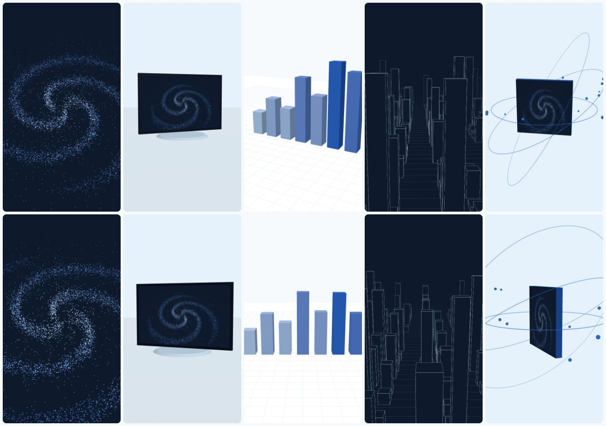

# 3D looks

Five three.js looks, captured frame by frame in the same headless Chrome (playwright-core) that the engine already drives. Not Remotion.

| look | what it is | needs |
|---|---|---|
| `particles` | a slow swirl of points | nothing |
| `turntable` | the site screenshot on a slab that turns on a stand | a screenshot |
| `tower` | a bar chart that rises from a grid | numbers |
| `city` | a flight over a wireframe city | nothing |
| `orbit` | the camera circles the brand logo with rings and dust | a logo |

**Deterministic.** Every look is a pure function of `(params, t)` with `t = frame / fps`. Randomness is a seeded generator. Nothing reads a clock or runs its own animation loop; `test/render3d.test.ts` renders frames out of order, twice, and in fresh pages and compares hashes, and bans clock APIs in `page/looks.js`.

**No GPU.** Chrome starts on ANGLE with SwiftShader (`--use-angle=swiftshader --enable-unsafe-swiftshader`), the path Debian's `chromium` in the Docker image takes. `scripts/look3d.ts bench` prints the renderer string so you can see it ran on SwiftShader. `MOOVI_3D_GPU=1` uses the machine's GPU instead.

**The art director picks.** A shot on the board can carry `look3d`; the choice is stored as `(:Scene)-[:USES_3D]->(:Look3D)` (queries `useLook3d`, `looksInRun`, `look3dUsage` in QUERIES.md). What a project already used goes into his prompt so looks vary. `suggestLook` is the rule-based fallback.

**Speed** (8-core Windows laptop, software GL, 2 s clips, includes PNG encode and transfer):

| look | 540x960 | 1080x1920 |
|---|---|---|
| particles (7000-point galaxy) | 0.8 s per second of film | 2.22 |
| turntable | 0.97 | 2.77 |
| tower | 0.79 | 2.34 |
| city | 0.87 | 2.17 |
| orbit | 0.73 | 1.79 |

Run `pnpm --filter @moovi/engine exec tsx scripts/look3d.ts bench 2 1080x1920` to measure on another machine (inside the Docker image too).

