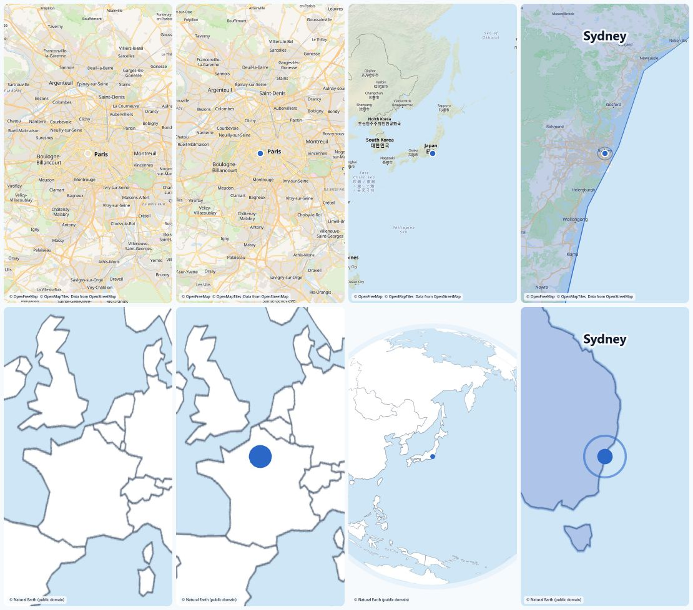

# Map shots

Scenes that name real places get a real map, captured frame by frame in the engine's headless Chrome (playwright-core).

- **Geocoding**: Nominatim, one request a second (a process-wide gate), a `Moovi/0.1 (... github.com/Ishaan-Gpt/moovi ...)` User-Agent (override with `MOOVI_NOMINATIM_UA`, `MOOVI_CONTACT`). Every answer is cached as `(:Place {name, lat, lon, cc, country})` in the shared `sys` graph, so a name is asked for once, ever.
- **Map**: MapLibre GL JS on free OpenFreeMap tiles (`liberty` style, water tinted to the brand ice blue). The attribution (© OpenFreeMap © OpenMapTiles, data from OpenStreetMap) is drawn on every frame.
- **Camera**: `maps/route.ts` is a pure function of time: fly-to between places (it pulls back mid-flight in proportion to the distance), a pin that pulses, the country highlighted with Natural Earth outlines once the camera lands. Node computes the camera for frame N and the page applies it with `jumpTo`; the capture then waits for MapLibre's `idle` (every tile loaded) before reading the frame.
- **Fallback**: if the style or tiles cannot load, the same flight is drawn on a three.js globe from Natural Earth outlines (public domain, downloaded once into `data/cache`, never committed). `mode: 'auto'` does it for you; one film never mixes the two.
- **Graph**: the art director's board lists `places` on a shot; they are geocoded and linked `(:Scene)-[:SHOWS {n}]->(:Place)` (`showPlace`, `placesInRun`, `placeUsage` in QUERIES.md). What a project already showed goes into his prompt.

## Speed (8-core Windows laptop, software GL, 540x960, 30 fps, a 3 s Paris → Tokyo → Sydney flight)

| mode | one page | four pages |
|---|---|---|
| tiles | 23.2 s per second of film | 17.6 |
| globe | 4.0 | 5.3 (no gain: it is already fast) |

A still frame costs about 0.6 s (software rasteriser); frames mid-flight cost 1.5-3 s when new tiles must be fetched. Measure with `pnpm --filter @moovi/engine exec tsx scripts/map3.ts bench Paris Tokyo Sydney`. If a film is short on time, use `mode: 'globe'`.

What is not done yet: compositing the rendered frames into the final film's scene program (the frames and `renderMap` are ready; the builder does not pull them in yet).

## In the film

A shot with `places` gets a poster of its map as a scene asset: the board spawns an `asset` task (`kind: map`, on the `chrome` resource, no model call) and `maps/asset.ts` renders the landed frame of the flight (88% through: pin pulsing, country highlighted, the name and the attribution on screen) at the film's size. Places are already cached, so it costs no Nominatim request. Tiles that fail give a globe poster and the asset's `about` says so. Full flights (`renderMap`) are not yet pulled into a scene program.
